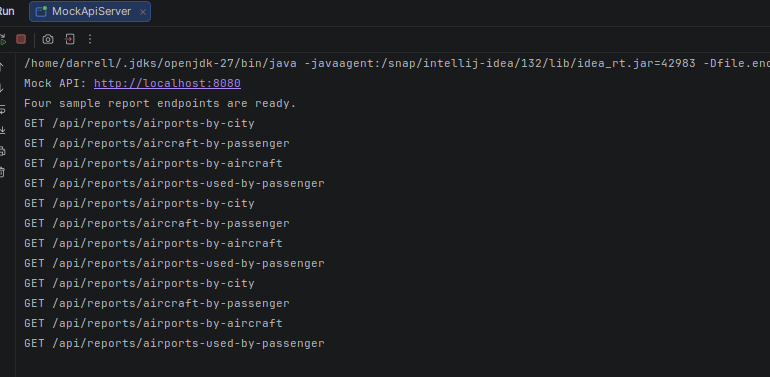
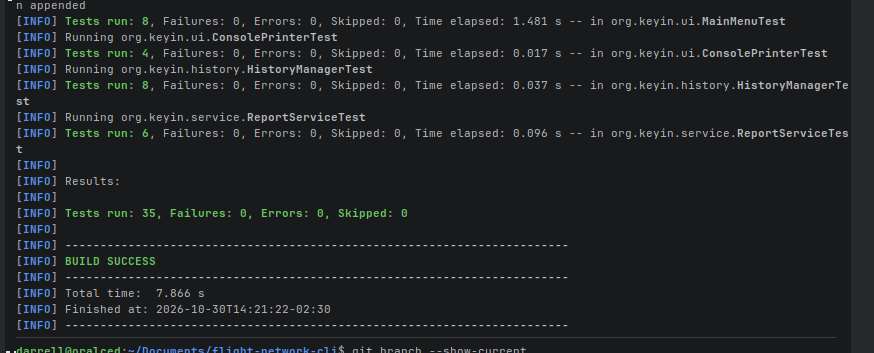
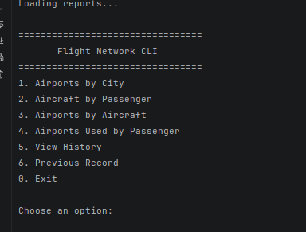
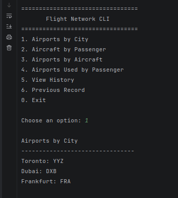
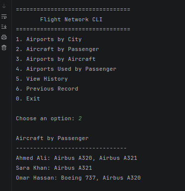
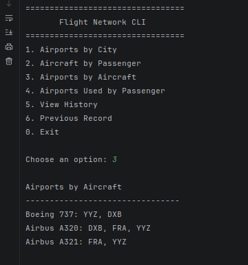
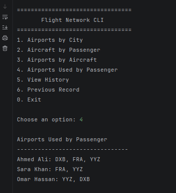

# Flight Network CLI

A Java command-line application that retrieves and displays flight network reports through HTTP.

This repository contains **Part 2 — CLI Client**. The Spring Boot API and database belong to a separate project.

## Features

- Retrieves four reports using HTTP GET requests.
- Caches reports for reuse during the session.
- Provides an interactive console menu.
- Records report viewing history with timestamps.
- Allows viewing the previous report.
- Handles invalid menu choices and API errors.
- Includes a mock API server for local development.
- Runs automated tests through GitHub Actions.

## Reports and Endpoints

| Report | HTTP method | Endpoint |
|---|---|---|
| Airports in each city | GET | `/api/reports/airports-by-city` |
| Aircraft each passenger has flown on | GET | `/api/reports/aircraft-by-passenger` |
| Airports used by each aircraft | GET | `/api/reports/airports-by-aircraft` |
| Airports used by each passenger | GET | `/api/reports/airports-used-by-passenger` |

On successful startup, the application makes exactly **four GET requests**, one per report.

The results are cached in memory. Selecting reports or browsing history does not send additional HTTP requests. Restarting the application loads fresh reports.

If report loading fails, the application reports the error instead of opening the menu with incomplete data.

## Technologies

- Java 27
- Maven
- Java HTTP Client
- Gson
- JUnit Jupiter
- Mockito
- GitHub Actions

## Requirements

- JDK 27
- Maven
- Git
- A running compatible API or the included `MockApiServer`

The CLI does not require a direct MySQL connection or database credentials.

## Getting Started

### 1. Clone the repository

```bash
git clone https://github.com/dralodrec/flight-network-cli.git
cd flight-network-cli
```

### 2. Verify your Java and Maven installation

```bash
java -version
mvn -version
```

Ensure Maven is using JDK 27.

### 3. Build and run the tests

```bash
mvn clean test
```

### 4. Open the project in IntelliJ IDEA

1. Open the project folder or its `pom.xml`.
2. Allow Maven to import the dependencies.
3. Set the project SDK to JDK 27.

## Running with the Mock API

The included mock server provides sample report data for local development.

1. Open and Run `src/main/java/org/keyin/dev/MockApiServer.java`.
2. Leave the mock server running.
3. Open `src/main/java/org/keyin/Main.java`.
4. Run its `main` method.

The default API base URL is:

```text
http://localhost:8080
```

The mock server is a development helper. It does not provide the database-backed implementation required for Part 1.

## Running with the Real API

1. Stop `MockApiServer`.
2. Start the separate backend API according to its setup instructions.
3. Confirm that the API supports the four report endpoints and expected JSON format.
4. Run the CLI.

The CLI accepts an optional API base URL as its first program argument.

In IntelliJ IDEA, open the run configuration for `Main` and enter the base URL under **Program arguments**, for example:

```text
http://localhost:8080
```

Use the base URL without a trailing slash. If no argument is supplied, the CLI uses `http://localhost:8080`.

When the API runs on another computer, use that server's reachable address instead of `localhost`.

## Menu

| Option | Action |
|---|---|
| 1 | Display airports by city |
| 2 | Display aircraft by passenger |
| 3 | Display airports by aircraft |
| 4 | Display airports used by passenger |
| 5 | Display viewing history |
| 6 | Display the previous report |
| 0 | Exit |

Viewing options 1–4 adds an entry to the session history.

The previous report is the second-most-recent history entry. At least two report views are needed. Displaying history or the previous report does not add another history entry.

History and cached reports are stored in memory and cleared when the application closes.

## Expected Response Format

Each report endpoint must return HTTP `200 OK` with a JSON object whose values are arrays of strings.

Example response for airports by city:

```json
{
  "Toronto": ["YYZ"],
  "Dubai": ["DXB"],
  "Frankfurt": ["FRA"]
}
```

The CLI converts this response into:

```java
Map<String, List<String>>
```

Example console output:

```text
Airports by City
------------------------------
Toronto: YYZ
Dubai: DXB
Frankfurt: FRA
```

The values above are sample data. Display order may vary.

## Application Structure

Production source files are located under `src/main/java/org/keyin`.

| Class | Responsibility |
|---|---|
| `Main` | Creates application components, loads reports, and starts the menu |
| `client/ApiClient` | Sends HTTP requests and converts JSON responses into Java data |
| `service/ReportService` | Loads and caches the four reports |
| `ui/MainMenu` | Handles user input and menu actions |
| `ui/ConsolePrinter` | Formats and displays report data |
| `history/HistoryManager` | Stores viewing history and retrieves the previous entry |
| `history/ReportRecord` | Represents a report viewing event |
| `dev/MockApiServer` | Serves sample responses for local development |

Tests are located under `src/test/java`.

## Testing

Run the full test suite:

```bash
mvn clean test
```

The current suite contains **35 tests**:

| Test class | Tests | Focus |
|---|---:|---|
| `HistoryManagerTest` | 8 | History records, ordering, snapshots, and previous entries |
| `ReportServiceTest` | 6 | Report loading, caching, validation, and failure handling |
| `ApiClientTest` | 9 | HTTP requests, response parsing, and error handling |
| `MainMenuTest` | 8 | Menu actions, invalid input, history, and exit behaviour |
| `ConsolePrinterTest` | 4 | Report formatting and empty values |

Mockito isolates selected dependencies. API client tests use a local HTTP test server to control responses.

You do not need to start `MockApiServer` manually before running the tests.

Test reports are generated in:

```text
target/surefire-reports/
```

## Continuous Integration

The GitHub Actions workflow is stored at:

```text
.github/workflows/tests.yml
```

It runs tests automatically for:

- Pull requests targeting `main` or `develop`.
- Pushes to `main` or `develop`, including merge commits.

The workflow runs:

```bash
mvn --batch-mode --no-transfer-progress clean test -DfailIfNoTests=true
```

The build fails if tests fail or no tests are executed.

## Branching Workflow

- `main`: submission and release branch.
- `develop`: integration branch for completed features.
- `feature/*`: individual development tasks.

Create feature branches from an updated `develop` branch. Open feature pull requests against `develop`, review the changes, and check the automated test results before merging.

Use a pull request from `develop` to `main` when preparing a release.

## Troubleshooting

| Problem | Check |
|---|---|
| Connection refused | Confirm that the API or mock server is running and the base URL is correct |
| Port 8080 already in use | Stop the other server before starting the mock or real API |
| HTTP 404 | Confirm that the server exposes the expected report paths |
| Invalid report response | Confirm that the response matches the expected JSON structure |
| Java compilation error | Check that both IntelliJ and Maven use JDK 27 |
| No previous report available | View at least two reports first |

## Scope and Current Status

The CLI implementation has been tested with mocks and local HTTP test servers.

Verification against the partner's real API is pending.

This repository does not implement:

- Spring Boot backend endpoints.
- Database connections or persistence.
- POST, PUT, or DELETE operations.
- Spring Data JPA pagination and sorting.

Those responsibilities belong to the separate Part 1 API project.

## Screenshots

### Four GET Requests

The server log shows one GET request for each report.



### Automated Tests

The test results show the completed test suite.



### CLI Menu




## The Four Questions the CLI Answers

1. **What airports are in each city?**  
   Displays each city and its associated airports.
   

2. **What aircraft has each passenger flown on?**  
   Displays each passenger and the aircraft they have travelled on.
   

3. **What airports does each aircraft take off from and land at?**  
   Displays each aircraft and its associated departure and arrival airports.
   

4. **What airports have passengers used?**  
   Displays each passenger and the airports they have travelled through.
   

Menu options 1–4 correspond to these questions. The CLI retrieves
each report through a separate HTTP GET request and caches the
results for the session.